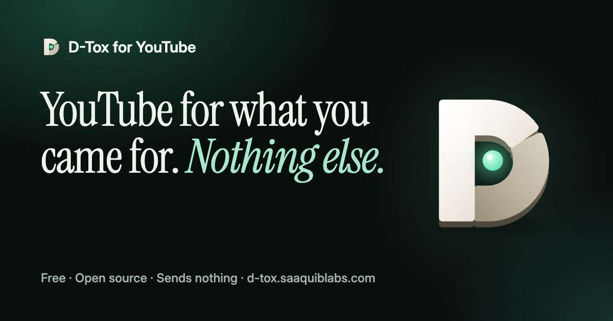

<p align="center"><a href="https://d-tox.saaquiblabs.com"></a></p>

# D-Tox for YouTube

**YouTube for what you came for. Nothing else.** D-Tox hides the parts of YouTube that pull you
elsewhere: the Home feed, Shorts, recommendations, autoplay. It stays measurably light. Free, open
source, sends nothing anywhere. A Saaquib Labs product. MIT.

[Add to Chrome](https://chromewebstore.google.com/detail/ocngpkbaoflpfjamgcnnjbdnhmakmgel) ·
[d-tox.saaquiblabs.com](https://d-tox.saaquiblabs.com) · [Privacy](https://d-tox.saaquiblabs.com/privacy) ·
[Report a problem](https://github.com/saaquiblabs/d-tox/issues)

> The rebuild (v2.0.0) is in progress: see `docs/STATUS.md`, `CONTEXT.md` and `docs/adr/`.

## Layout

| Path | What |
|------|------|
| `settings.json` | The only list of Settings. The extension, site and checks all read it. |
| `extension/` | The Chrome extension (Manifest V3, plain TypeScript and CSS, built with esbuild). |
| `site/` | The product page, `d-tox.saaquiblabs.com`. |
| `checks/` | Live-YouTube checks run as Openship jobs (nightly check, Release Gate). |
| `docs/` | Decisions (`adr/`), research and status. |

## Extension

```bash
cd extension
npm ci
npx playwright install chromium   # once
npm run build          # dist/ — fails above 40 KB excluding icons
npm test               # typecheck, build, saved-page tests
```

Load `extension/dist` from `chrome://extensions` → Developer mode → Load unpacked.

### How hiding works

`extension/src/hide.css` and `extension/src/hide-rys.css` (selectors ported from RYS, kept
MPL-2.0) are declared in the manifest, so Chrome applies them before YouTube draws.
Each rule is gated on an attribute on `<html>` (`html[data-dtox-comments] …`) and scoped to its
page. `extension/src/content.ts` copies Settings from `chrome.storage.sync` onto `<html>` and
follows storage changes, which is how the popup applies to open tabs at once (ADR 0001).
JavaScript does only what CSS can't: it adds the Intention Page's one element (shown by
`extension/src/intention.css`), Autoplay off clicks YouTube's own autoplay button, and the
Shorts and Home-on-Subscriptions redirects, all on YouTube's own events (no timers, no
observers). `extension/src/background.ts` opens `/welcome` on install, and does nothing else.

### Adding a Setting

1. Add it to `settings.json` (id, name, "Hides …" line, group, type, Calm Default value). A
   Setting that changes a behaviour rather than hiding something says "Turns …" instead.
   `calmDefault` is `true`/`false` for a switch. A choice (Home) also lists its `choices`
   (`id`, `name`), one of them `default` (YouTube's own, which sets no attribute), and
   `calmDefault` is the value it starts on. The popup shows a choice as a select, and its rules can
   be gated on its value, `html[data-dtox-<id>="<value>"]`.
2. Hiding: add its rule to `extension/src/hide.css`, gated on `html[data-dtox-<id>]` and scoped
   to its page. Selectors ported from RYS go in `extension/src/hide-rys.css`, which stays
   MPL-2.0. A behaviour CSS can't change goes in `extension/src/content.ts`, driven by YouTube's
   own events.
3. Add a case to `extension/tests/cases.ts`; if it needs a page not yet saved, capture one with
   `node tests/fixtures/capture.mjs <name> <youtube url> [width]`. The tests fail until both
   exist. A hiding Setting lists its `distractions` and what it `keeps`, and other pages it acts
   on under `elsewhere`; `settings.spec.ts` tests it from that, and also checks it hides nothing
   else on every saved page. A behaviour Setting names its own `spec` file in `tests/`.
4. If it is in the Calm Default, `/welcome` lists it on the next site build (`site/`); its "hides"
   line is what the page shows.

## Site

```bash
cd site
npm ci
npm run dev            # http://localhost:4321
npm run verify         # tests, build, /welcome vs settings.json, links, Lighthouse 100s
```

Details and the go-live steps: `site/README.md`.
